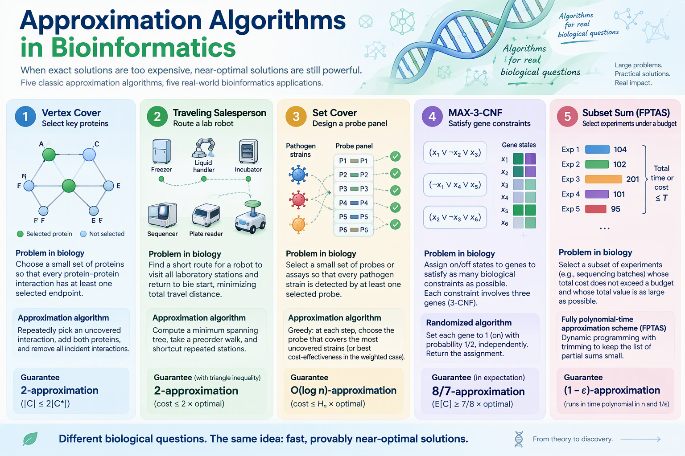

# Approximation Algorithms in Bioinformatics

## Why approximation matters in bioinformatics

Many bioinformatics problems involve a huge number of possible choices: genes to perturb, samples to process, probes to select, experiments to schedule, or molecular constraints to satisfy. Finding the exact optimum may require testing an exponential number of combinations.

Approximation algorithms take a different approach. They run in polynomial time and return a solution with a mathematical guarantee describing how far it can be from the optimum.

This article connects five classical approximation problems to concrete bioinformatics scenarios:

1. vertex cover for selecting proteins or genes that touch every interaction;
2. metric traveling salesperson for routing a laboratory robot among sample locations;
3. set cover for selecting a small panel of probes or assays;
4. randomized MAX-3-CNF for satisfying many perturbation constraints;
5. an FPTAS for subset sum when selecting experiments under a fixed resource capacity.

*Overview of five approximation algorithms and their bioinformatics applications: vertex cover, metric TSP, set cover, MAX-3-CNF, and subset sum.*

The biological examples explain how the mathematical structure can arise. They do not imply that every real biological problem should be reduced to one of these models.

---

# 1. Vertex Cover: Selecting Proteins That Touch Every Interaction

## Biological problem

Suppose a protein-protein interaction network contains interactions that need experimental follow-up. Testing both proteins in every interaction would be expensive. Instead, we want to select a small set of proteins such that every interaction has at least one selected endpoint.

Represent the system as an undirected graph:

- each vertex is a protein;
- each edge is an interaction;
- selecting a vertex means measuring, perturbing, or experimentally validating that protein.

A set of selected proteins is a **vertex cover** if every interaction has at least one endpoint in the set.

## Example network

Let:

$$
V=\{A,B,C,D,E,F\}
$$

and:

$$
E=\{(A,B),(A,C),(B,D),(C,D),(D,E),(D,F)\}.
$$

The goal is to find a vertex cover with as few proteins as possible.

## The book's approximation algorithm

The algorithm repeatedly:

1. chooses any remaining edge $(u,v)$;
2. adds both $u$ and $v$ to the cover;
3. removes that edge and every edge incident on $u$ or $v$;
4. stops when no edge remains.

Assume the algorithm first selects $(A,B)$. It adds both proteins:

$$
C=\{A,B\}.
$$

It removes:

$$
(A,B),(A,C),(B,D).
$$

The remaining edges are:

$$
(C,D),(D,E),(D,F).
$$

Suppose it next selects $(C,D)$. It adds both endpoints:

$$
C=\{A,B,C,D\}.
$$

All remaining edges are incident on $C$ or $D$, so the algorithm stops.

## Why this is a 2-approximation

The selected edges are:

$$
A_M=\{(A,B),(C,D)\}.
$$

They share no endpoints, so they form a matching. Any vertex cover, including the optimum $C^*$, must contain at least one endpoint from each matching edge:

$$
|C^*|\geq |A_M|=2.
$$

The algorithm takes both endpoints of each selected edge:

$$
|C|=2|A_M|=4.
$$

Therefore:

$$
|C|=2|A_M|\leq 2|C^*|.
$$

For this network, the set:

$$
C^*=\{A,D\}
$$

is an optimal vertex cover. Protein $A$ covers $(A,B)$ and $(A,C)$, while protein $D$ covers the other four edges. The approximation algorithm returns four proteins, while the optimum uses two, reaching the worst-case ratio of 2.

## Bioinformatics interpretation

The result means that every modeled interaction has at least one selected protein. It does not prove that the selected proteins are causal disease drivers or good drug targets. If experiments have different costs, use **minimum-weight vertex cover** rather than the unweighted model.

---

# 2. Metric Traveling Salesperson: Routing a Laboratory Robot

## Biological problem

Consider an automated laboratory with a robot that must collect samples from several stations:

- a freezer;
- a liquid handler;
- an incubator;
- a sequencer loading station;
- a plate reader.

The robot starts at one location, visits every station once, and returns to the start. The objective is to minimize total travel distance or time.

This is a traveling-salesperson problem. The approximation algorithm applies when the cost satisfies the triangle inequality:

$$
c(u,w)\leq c(u,v)+c(v,w).
$$

Traveling directly from station $u$ to station $w$ must not cost more than traveling through an intermediate station $v$.

## Example station coordinates

Assume five laboratory stations have the following coordinates in meters:

| Station | Coordinate |
|---|---:|
| A: sample freezer | $(0,0)$ |
| B: liquid handler | $(2,0)$ |
| C: incubator | $(2,2)$ |
| D: plate reader | $(0,2)$ |
| E: sequencer loader | $(1,3)$ |

Use Euclidean distance as the cost. Euclidean distance satisfies the triangle inequality.

## The book's approximation algorithm

The algorithm has three main steps:

1. choose any station as a root;
2. compute a minimum spanning tree $T$;
3. list stations in the order they are first visited by a preorder walk of $T$, then return to the root.

One minimum spanning tree is:

$$
T=\{(A,B),(A,D),(D,E),(E,C)\}.
$$

Its cost is:

$$
c(T)=2+2+\sqrt2+\sqrt2\approx 6.83.
$$

Rooting the tree at $A$, one preorder is:

$$
A,B,D,E,C.
$$

The returned tour is:

$$
A\rightarrow B\rightarrow D\rightarrow E\rightarrow C\rightarrow A.
$$

Its approximate cost is:

$$
2+\sqrt8+\sqrt2+\sqrt2+\sqrt8\approx 10.49.
$$

A different child order can produce a different tour, but the same theoretical guarantee remains.

## Why this is a 2-approximation

Let $H^*$ be an optimal tour. Removing one edge from $H^*$ leaves a spanning tree, so the minimum spanning tree is a lower bound:

$$
c(T)\leq c(H^*).
$$

A full walk around the tree traverses every tree edge twice:

$$
c(W)=2c(T)\leq2c(H^*).
$$

The full walk may revisit stations. The triangle inequality lets us skip repeated stations without increasing cost. Therefore, the preorder tour $H$ satisfies:

$$
c(H)\leq c(W)\leq2c(H^*).
$$

## Bioinformatics interpretation

This model is useful for physical laboratory routing, sample pickup, imaging-stage movement, or mobile sensor collection. It is not appropriate if direct travel can be more expensive than an indirect route because of one-way corridors, contamination constraints, access restrictions, or required decontamination steps. Without the triangle inequality, the chapter shows that no polynomial-time constant-factor approximation exists for general TSP unless $P=NP$.

---

# 3. Set Cover: Designing a Small Biomarker or Probe Panel

## Biological problem

Suppose researchers want to detect six pathogen strains:

$$
X=\{s_1,s_2,s_3,s_4,s_5,s_6\}.
$$

Each candidate probe detects a subset of strains:

$$
\begin{aligned}
P_1&=\{s_1,s_2,s_3\},\\
P_2&=\{s_2,s_4\},\\
P_3&=\{s_3,s_4,s_5\},\\
P_4&=\{s_1,s_5\},\\
P_5&=\{s_4,s_5,s_6\},\\
P_6&=\{s_6\}.
\end{aligned}
$$

The objective is to select as few probes as possible while detecting every strain.

This is a set-cover problem:

- the universe $X$ contains the strains;
- each probe is a subset of strains;
- the selected probes must cover all elements of $X$.

## The greedy algorithm

At every iteration, select the probe that covers the largest number of currently uncovered strains.

Initially:

$$
U_0=X.
$$

Both $P_1$, $P_3$, and $P_5$ cover three strains. Suppose ties are broken in favor of $P_1$. Select:

$$
P_1=\{s_1,s_2,s_3\}.
$$

The uncovered set becomes:

$$
U_1=\{s_4,s_5,s_6\}.
$$

Now $P_5$ covers all three remaining strains, so select $P_5$:

$$
P_5=\{s_4,s_5,s_6\}.
$$

The algorithm returns:

$$
C=\{P_1,P_5\}.
$$

All six strains are covered, and in this example the greedy solution is also optimal.

## Approximation guarantee

The chapter's greedy set-cover algorithm is a polynomial-time:

$$
O(\log |X|)
$$

approximation algorithm. More specifically, its analysis gives a bound based on the logarithm of the universe size.

If an optimal solution contains $k$ sets, then at any stage the remaining uncovered elements can still be covered by at most $k$ optimal sets. Therefore, at least one of those sets covers at least a $1/k$ fraction of the remaining elements. Since the greedy algorithm chooses the set covering the most remaining elements, the number of uncovered elements decreases geometrically:

$$
|U_{i+1}|\leq |U_i|\left(1-\frac1k\right).
$$

This leads to a logarithmic approximation factor.

## Bioinformatics interpretation

Set cover can model:

- selecting probes that cover pathogen strains;
- selecting antibodies that recognize a collection of antigens;
- choosing guide RNAs that cover target variants;
- selecting experiments that collectively examine all pathways of interest;
- designing a compact marker panel that covers predefined cell populations.

The standard algorithm minimizes the number of selected sets. If probes have different prices, failure rates, or preparation times, use weighted set cover and choose by cost per newly covered element rather than raw coverage alone.

---

# 4. Randomized MAX-3-CNF: Satisfying Perturbation Constraints

## Biological problem

Suppose each Boolean variable represents whether a gene receives a selected perturbation:

$$
x_i\in\{0,1\}.
$$

A biological requirement is represented as a clause of three distinct literals, for example:

$$
(x_1\lor\neg x_2\lor x_3).
$$

The clause is satisfied if gene 1 is perturbed, gene 2 is not perturbed, or gene 3 is perturbed.

When requirements conflict, it may be impossible to satisfy all clauses. MAX-3-CNF asks for an assignment that satisfies as many clauses as possible.

## Example formula

Consider:

$$
\begin{aligned}
K_1&=(x_1\lor\neg x_2\lor x_3),\\
K_2&=(\neg x_1\lor x_4\lor x_5),\\
K_3&=(x_2\lor\neg x_3\lor x_6),\\
K_4&=(\neg x_4\lor x_5\lor\neg x_6).
\end{aligned}
$$

The randomized algorithm independently assigns every variable:

$$
\Pr(x_i=1)=\Pr(x_i=0)=\frac12.
$$

For one clause, all three literals are false with probability:

$$
\left(\frac12\right)^3=\frac18.
$$

Therefore, each clause is satisfied with probability:

$$
1-\frac18=\frac78.
$$

If $Y_i$ indicates whether clause $i$ is satisfied and $Y$ is the total number satisfied, then:

$$
E[Y]=\sum_{i=1}^{m}E[Y_i]=\frac{7m}{8}.
$$

Since the optimum cannot satisfy more than $m$ clauses:

$$
\frac{C^*}{E[C]}
\leq
\frac{m}{7m/8}
=
\frac87.
$$

The method is a randomized $8/7$-approximation algorithm.

## Bioinformatics interpretation

The method can generate candidate gene-state assignments for a Boolean regulatory model. However, the guarantee applies to the encoded clauses, not to biological effectiveness. It assumes exactly three distinct literals per clause, independent uniform assignments, and initially excludes clauses containing both a variable and its negation. Shared variables across different clauses do not break the expectation proof because linearity of expectation does not require the clauses to be independent.

---

# 5. Subset Sum FPTAS: Selecting Experiments Under a Capacity Limit

## Biological problem

Suppose a sequencing facility has a daily processing capacity of:

$$
t=308
$$

million reads. Four candidate sample batches require:

$$
S=\{104,102,201,101\}
$$

million reads.

The objective is to select a subset whose total is as large as possible without exceeding 308 million reads.

This is the optimization version of subset sum:

$$
\max \sum_{x_i\in S'}x_i
\quad\text{subject to}\quad
\sum_{x_i\in S'}x_i\leq t.
$$

The exact optimum is:

$$
104+102+101=307.
$$

## Exact dynamic programming idea

The exact algorithm maintains a list $L_i$ of every subset sum obtainable from the first $i$ values that does not exceed $t$.

Starting with:

$$
L_0=\langle0\rangle,
$$

it repeatedly merges:

$$
L_{i-1}
$$

with:

$$
L_{i-1}+x_i,
$$

then removes values larger than $t$.

The list can contain exponentially many values, so the exact method is exponential in general.

## The approximation idea: trim close values

The FPTAS keeps the lists small by removing values that are close to one another. If a retained value $z$ approximately represents a removed value $y$, then:

$$
\frac{y}{1+\delta}\leq z\leq y.
$$

For approximation parameter $\epsilon$, the algorithm uses:

$$
\delta=\frac{\epsilon}{2n}.
$$

The procedure for each input value is:

1. merge $L_{i-1}$ with $L_{i-1}+x_i$;
2. trim the merged list using $\epsilon/(2n)$;
3. remove every value greater than $t$.

## Worked example from the chapter

Use:

$$
S=\langle104,102,201,101\rangle,
\quad t=308,
\quad\epsilon=0.40.
$$

Since $n=4$:

$$
\delta=\frac{0.40}{2\times4}=0.05.
$$

The lists evolve as follows.

After 104:

$$
L_1=\langle0,104\rangle.
$$

After merging 102:

$$
\langle0,102,104,206\rangle.
$$

Trimming removes 104 because it is sufficiently close to 102:

$$
L_2=\langle0,102,206\rangle.
$$

After adding 201, merging, trimming, and removing values above 308:

$$
L_3=\langle0,102,201,303\rangle.
$$

After adding 101, the merged list is:

$$
\langle0,101,102,201,203,302,303,404\rangle.
$$

After trimming:

$$
\langle0,101,201,302,404\rangle.
$$

After removing values above 308:

$$
L_4=\langle0,101,201,302\rangle.
$$

The algorithm returns:

$$
z^*=302.
$$

The exact optimum is 307, so the observed relative loss is:

$$
\frac{307-302}{307}\approx1.63\%.
$$

This is much better than the allowed $40\%$ approximation parameter in this example.

## Why it is an FPTAS

The algorithm returns a feasible subset sum no larger than $t$, and its analysis guarantees:

$$
\frac{y^*}{z^*}\leq1+\epsilon,
$$

where $y^*$ is the optimum.

Its running time is polynomial in both:

$$
n
$$

and:

$$
\frac1\epsilon.
$$

It is therefore a **fully polynomial-time approximation scheme**.

## Bioinformatics interpretation

The model can represent selecting independent batches under a sequencing-read budget, choosing experiments under a time capacity, or filling a fixed storage budget. The objective only maximizes total utilized capacity. It does not account for scientific value, dependencies, sample priority, or batch compatibility. If each experiment has separate cost and scientific value, the problem is closer to 0-1 knapsack than plain subset sum.

---

# Comparing the Five Methods

| Problem | Bioinformatics example | Objective | Technique | Guarantee |
|---|---|---|---|---|
| Vertex cover | Select proteins touching every interaction | Minimize selected proteins | Maximal matching endpoints | $2$-approximation |
| Metric TSP | Route a robot among lab stations | Minimize travel cost | Minimum spanning tree and preorder walk | $2$-approximation |
| Set cover | Select probes covering all strains | Minimize selected probes | Greedy maximum uncovered coverage | $O(\log \lvert X\rvert)$ |
| MAX-3-CNF | Satisfy gene-perturbation constraints | Maximize satisfied clauses | Independent random assignments | Expected $8/7$-approximation |
| Subset sum | Fill sequencing capacity without exceeding it | Maximize selected total | Dynamic programming with trimming | FPTAS, ratio $1+\epsilon$ |

## A common pattern

Although the five algorithms use different techniques, they follow a shared strategy:

1. define a precise optimization objective;
2. identify a structure that is easier to compute;
3. relate that structure to the unknown optimum;
4. return a feasible solution in polynomial time;
5. prove a bound on how far the result can be from optimal.

The lower bound for vertex cover comes from a matching. The lower bound for metric TSP comes from a minimum spanning tree. Set cover uses the rate at which uncovered elements shrink. MAX-3-CNF uses expected value. Subset sum controls accumulated error by trimming close states.

## Final perspective

Approximation algorithms do not remove biological uncertainty. They solve a well-defined mathematical model efficiently and provide a quality guarantee relative to that model.

A strong bioinformatics application therefore requires two separate validations:

- **algorithmic validation:** the implementation satisfies the approximation analysis;
- **biological validation:** the variables, costs, edges, sets, clauses, and constraints accurately represent the experimental question.

**The approximation guarantee tells us how well we solve the model. The biology determines whether we chose the right model.**

## Source

The algorithms and approximation guarantees in this article follow Chapter 35 of the supplied *Introduction to Algorithms* by Cormen, Leiserson, Rivest, and Stein (CLRS).
